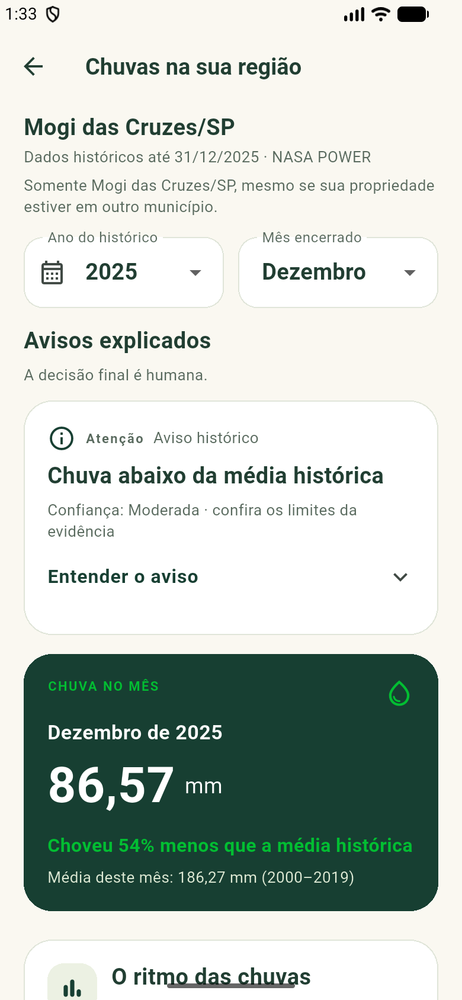
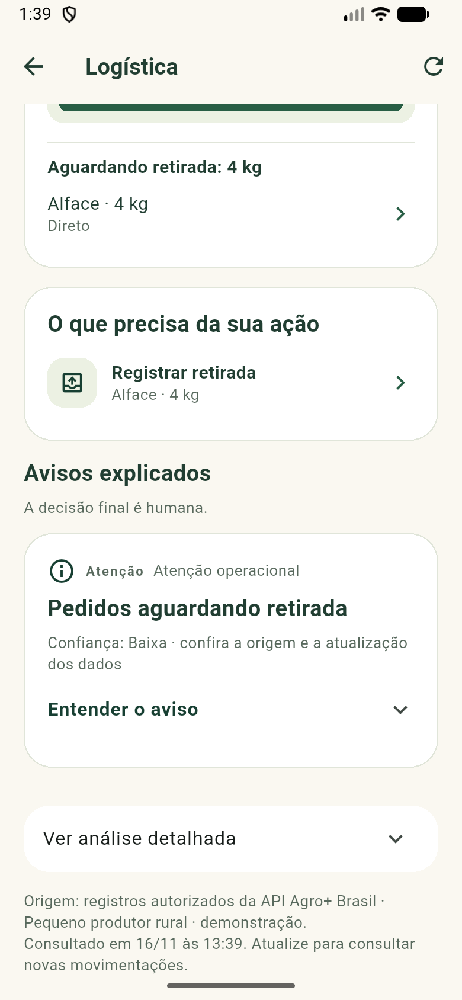

# Aplicativo Flutter / Dart

Aplicativo Flutter orientado às tarefas do pequeno produtor rural, com produção, ofertas, pedidos, histórico e perfil. Interface em português, fonte Roboto local, navegação inferior com cinco destinos e árvore semântica habilitada na web. O primeiro dashboard territorial, **Inteligência Hídrica**, está disponível pelo ícone de gota no cabeçalho mobile/desktop; a navegação de tarefas continua preservada.

## Avisos explicados nos três dashboards

O critério 3 do enunciado CPAD admite regras sobre os dados. Os avisos usam regras determinísticas, sem probabilidades inventadas ou execução de modelos. Cada card mostra título, nível de atenção, categoria e confiança. **Entender o aviso** expande justificativa, evidência (indicador, valor, período e fonte), fundamento da confiança, limitações e orientação para avaliação humana. Nenhuma decisão ou alteração comercial é automática.

| Painel | Regra e escopo | Limites |
| --- | --- | --- |
| Inteligência Hídrica | Acumulado mensal menor que a média do mesmo mês em 2000–2019; atenção quando menor que Q25; classificação preserva limites Q10/Q25 do AGUA-04. | Aviso histórico regional de Mogi das Cruzes/SP, NASA POWER, dados até 31/12/2025. Não é previsão operacional de seca ou escassez. Sem referência ou valor válido, comparação indisponível e confiança baixa. |
| Produção e excedentes | Ofertas PUBLICADA com saldo positivo e vencimento em (0, 72h], pedidos SOLICITADO e soma de availableKg em ofertas válidas da propriedade. | Não confunde produção com excedente; vencimento não prova perda. A janela de três dias já existia no resumo e é regra da interface. O filtro de ano de colheita não altera esses avisos operacionais. |
| Logística | Contagem dos estados SOLICITADO, ACEITO e RETIRADO dos pedidos vinculados à propriedade. | Não cria atraso, prazo, rota ou chegada prevista. Criação do pedido não é data de transição. Cooperativa e destinatário continuam responsáveis por suas etapas. |

Confiança **moderada** descreve uma comparação histórica com referência de 20 anos, ou uma leitura determinística dos registros autorizados consultados; não mede acerto futuro. Confiança **baixa** identifica demonstração fictícia, datas de criação ausentes, dados insuficientes, cópia offline, consulta com mais de 15 minutos ou relógio anterior à consulta. O limite de 15 minutos é uma política conservadora da interface, sem validação científica ou garantia de atualidade antes dele. A seção reavalia a idade a cada minuto e ao retomar o app.

Offline/consulta antiga: avisos operacionais são avaliados na data da cópia e identificados como desatualizados, sem projetar saldo como atual. O histórico hídrico continua explicitamente retrospectivo. Repositórios existentes mantêm paginação completa, isolamento por origem/usuário/organização/propriedade, validação e recusa de fallback em 401/403/404. Revogação não pode ser verificada sem conexão. Não foi criado cache adicional para os avisos.

Implementação: `territorial/explained_alert.dart` (regras puras), `territorial/alert_card.dart` (componente compartilhado com expansão acessível) e integração nos três dashboards. Usa apenas Flutter e componentes/cores existentes. Sem novas dependências, redesign, endpoints, métricas científicas ou alteração dos modelos congelados. Texto sem altura fixa, cabeçalhos semânticos e expansão discreta que respeita movimento reduzido; carregamento/erro ficam sob os FutureBuilders existentes, e ausência de avisos não implica ausência de risco.

Validação e capturas: [relatório de alertas](../../docs/design/alertas/resultado.md). Testes em `test/explained_alert_test.dart` cobrem limites, confiança, dados ausentes, isolamento, cópia offline, atualização da seção, expansão real nos três dashboards, 320/900 dp com texto 200% e critérios de contraste/rótulos/alvos Android.

### Capturas Android dos avisos

| Inteligência Hídrica | Produção e excedentes | Logística |
| --- | --- | --- |
|  |  |  |
|  |  |  |

[Logística em 320 dp com texto ampliado](assets/screenshots/alertas/logistica-retirada-320-texto-200.png). Capturas do emulador, sem montagem; operações fictícias identificadas, histórico hídrico real.

## Produção e excedentes — segundo dashboard

Na aba **Produção**, toque em **Produção e excedentes**. O painel agrega todas as páginas das produções autorizadas e filtra pela propriedade escolhida; não usa o indicador organizacional como total local. O ano refere-se à data da colheita. Saldos e pendências consideram todas as colheitas da propriedade, independentemente desse filtro, e são identificados assim na tela.

Somente `availableKg` de ofertas PUBLICADAS com prazo futuro entra em venda/doação. Esse campo já desconta reservas: pedidos não são subtraídos novamente. Rascunhos, ofertas vencidas e lotes de outras propriedades ficam fora. A produção registrada não é tratada como excedente. A análise detalhada mantém safras, meses registrados, original ofertado em ofertas vigentes e quantidades de pedidos por estado, sem estimar estoque físico ou crescimento.

Cache privado de consulta por origem/usuário/organização/propriedade, sem tokens. Erro de rede/5xx permite snapshot explicitamente desatualizado; erros de autorização/consistência não permitem fallback. Atualizar tenta reconectar mesmo quando a home estava offline. Sair limpa o novo cache das propriedades da sessão junto dos snapshots existentes. A sessão inicial continua exigindo autenticação online. As ações abrem as telas operacionais existentes; nenhuma escrita é feita pelo dashboard.

[Auditoria de contratos](../../docs/design/production/auditoria.md) e [validação/evidências](../../docs/design/production/resultado.md). `scripts/smoke-production.mjs` usa MongoDB/Express isolados e 205 produções de teste para conferir paginação, reservas, venda/doação e troca para propriedade vazia. Dados de evidência são demonstrativos e identificados, nunca estatísticas regionais.

## Logística — terceiro dashboard

Na aba **Pedidos**, toque em **Acompanhar logística**. O painel mostra pedidos em andamento, a distribuição por situação, o que depende do produtor e, quando há confirmação, os municípios de retirada e recebimento. Usa `/productions`, `/orders` e `/lots/:id/events`, sem rotas, distâncias ou previsões, que não existem no contrato. Retirada não é recebimento: só o destinatário confirma.

[Auditoria de contratos](../../docs/design/logistics/auditoria.md) e [validação/evidências](../../docs/design/logistics/resultado.md). `scripts/serve-logistics-android.mjs` sobe uma API isolada na porta 3310, com estados criados pelos comandos reais; `test/live_logistics_api.dart` a consulta por HTTP.

## Inteligência Hídrica — incremento 1

Painel independente de Mogi das Cruzes/SP, NASA POWER AG, histórico **2000–2025**, referência estatística **2000–2019**. Filtros de ano/mês, barras comparativas selecionáveis, acumulados de 7/30 dias, sequência diária e dias de baixa chuva no mês, anomalias com interpretação e proveniência. Nenhuma observação é apresentada como condição atual. LST é tratado como calendário da fonte, sem conversão para o fuso civil.

Sem endpoint AGUA-04: os arquivos auditados são embarcados em `assets/agua04/`. A consulta funciona sem rede inclusive na galeria, não escreve no SharedPreferences e não depende da propriedade escolhida. A autenticação inicial da sessão normal continua exigindo a API; isso não cria login frio offline. Reabrir o painel relê o mesmo pacote, sem atualizar observações. O modelo Ridge não é executado ou apresentado como previsão.

Da raiz, `python scripts/export-agua04-mobile.py --check` verifica inventário SHA-256, cópias e proveniência; sem `--check`, copia a versão auditada, sem treinar, inferir ou alterar o pipeline. Contrato incompatível e arquivos inválidos produzem erro recuperável; ausentes continuam indisponíveis. As classes diárias são preservadas do CSV, pois precedem o arredondamento de sua serialização. Faixas mensais usam os limiares exportados, sem arredondamento adicional.

Componentes em `lib/territorial/dashboard_components.dart`: cabeçalho territorial, filtro anual, cards/grid de indicadores, gráfico com alvos de 48 dp e semântica, legenda e estados de carregamento/vazio/erro/desatualizado. Pacotes históricos não vencem como clima ao vivo. Movimentos próprios respeitam `disableAnimations` e `accessibleNavigation`; texto ampliado reorganiza os cards e filtros.

Validação e evidências deste incremento: [relatório](../../docs/design/territorial/resultado.md), [auditoria](../../docs/design/territorial/auditoria.md), [gravação Android](../../docs/design/territorial/evidencias/agua04-navegacao-android.mp4). Para reproduzir no emulador: `flutter build apk --debug --dart-define=DEMO_GALLERY=true`; instalar o APK e executar `scripts/capture-agua04-android.ps1` da raiz. A home da galeria é fictícia e identificada; o painel usa os exports reais, mesmo dentro da galeria.

## Executar

Com o MongoDB/API da raiz ativos, nesta pasta:

```powershell
flutter pub get
flutter analyze
flutter test
flutter build web --base-href /mobile/ --no-web-resources-cdn
```

Abra **http://127.0.0.1:3000/mobile/**. A API Express serve o build e o Flutter consulta `/api/v1` na mesma origem, sem abrir CORS. Se o servidor estava executando uma versão anterior, reinicie `npm.cmd start` na raiz. Não substitua seu `.env` existente.

Use o token fictício PEQUENO_PRODUTOR_RURAL de `.data/demo-sessions.json`, verifique o acesso e selecione uma organização autorizada. A propriedade pode ser alterada na home. Token apenas em memória: não usar token em dart-define, URL, assets ou armazenamento local. Login real de produção permanece pendente.

Os quatro atalhos abrem cadastro real de produção, criação de rascunho da oferta, listagem/histórico de lotes e pedidos. A aba Ofertas permite publicar o rascunho. Pedidos permitem aceite com cooperativa opcional, cancelamento e retirada conforme backend; confirmação de recebimento cabe ao destinatário, não ao pequeno produtor rural. Cada alteração exige confirmação de localização. A API continua sendo a autoridade de permissões e estados.

## Estados, cache e limites

Home: primeiro acesso, solicitação aguardando resposta, aceite aguardando retirada, retirada aguardando recebimento, nenhuma pendência, carregamento, erro e acesso ao serviço indisponível com cache. Há no máximo duas pendências, ordenadas pelo backend (ação antes de acompanhamento), e dois lotes recentes por propriedade. Sem contadores zerados, coletas agendadas ou clima inventados.

O cache SharedPreferences guarda somente catálogo e snapshot da home por origem/usuário/organização/propriedade. Nunca guarda tokens. Na perda de acesso ao serviço durante a sessão, mostra a última cópia e seu horário, sem alterações ou fila de envio. O histórico offline contém apenas a última movimentação salva; listas completas e formulários exigem conexão. 401/403/404 não ativam fallback de cache. Sair remove os snapshots da sessão. Revogação não pode ser verificada offline: cache é somente consulta local previamente autorizada. Primeira autenticação/carga ainda exige acesso à API; não há promessa de login frio offline ou PWA instalável completa.

## Clima

O endpoint autenticado `GET /properties/:id/weather` prioriza coordenadas da propriedade com `verified: true` e `consent: true`. Sem elas, resolve município/UF/BR com OpenWeather Geocoding, validando nome, país e estado. Resultados ambíguos são recusados. A referência municipal é identificada como aproximada e persiste no MongoDB por 30 dias, inclusive entre reinícios. Não há uso automático do GPS.

Configuração exclusivamente no backend: `WEATHER_ENABLED=true` e `OPENWEATHER_API_KEY` no `.env` ignorado pelo Git; depois reiniciar a API. Não colocar chave no Dart, assets, URLs do aplicativo ou logs. Sem chave a integração continua desabilitada. Cadastro e verificação de coordenadas ainda não possuem interface.

Cache de até dez minutos, limitado à validade da observação (duas horas), timeout de quatro segundos por chamada e orçamento de 50 chamadas upstream/minuto por processo (inclui geocodificação). Ajustar o construtor conforme quota do plano; não é limitador distribuído. O resumo exibe localidade, temperatura, condição, horário e atribuição com logo/link oficiais. Offline apresenta a cópia salva explicitamente como não atual. Umidade do ar permanece no contrato, sem inferir solo ou irrigação. Não há previsão de chuva nesta etapa.

Não havia chave configurada nesta execução: consulta meteorológica real e captura com dados do provedor permanecem pendentes. [Relatório e logs](../../docs/evidencias/openweather/relatorio.md). Documentação: [Current Weather](https://openweathermap.org/api/current), [Geocoding](https://openweathermap.org/api/geocoding-api), [atribuição](https://openweathermap.org/faq). Confirmar produtos, quota e licença da conta antes de ativar.
## Demonstração e testes

Capturas reais do renderer Flutter, com fixtures identificadas: [oito estados](../../docs/evidencias/mobile/README.md). Fixtures nunca são inseridas no MongoDB. Galeria opcional, exclusivamente demonstrativa e sem gravações:

```powershell
flutter run -d chrome --dart-define=DEMO_GALLERY=true
```

O modo normal conecta a API; a galeria tem Repository separado. Para regenerar as capturas, executar `flutter test --update-goldens`. Para o teste Dart HTTP **real**, somente leitura e com API/seed ativos: `flutter test test/live_api.dart`. O comando não imprime tokens e salva `docs/evidencias/flutter-api-real.json`.

Os testes cobrem navegação, oito estados, snapshot offline, isolamento do cache, erro de autorização, contraste, rótulos, alvo de toque e layout 320 px/texto 200%. O incremento hídrico acrescenta testes dos agregados reais, contrato, limiares, nulos e controles do dashboard. O APK Android foi compilado e testado em emulador; as limitações antigas do toolchain foram superadas para Android. iOS e desempenho em aparelho físico permanecem sem validação. A fonte Roboto foi copiada do SDK Flutter com sua licença em `assets/fonts/roboto_license.txt`.

## Fora desta execução

Previsões operacionais validadas, QR Code, autenticação de produção, aplicativo dos outros três públicos e telas avançadas. Os avisos por regras e o indicador de benefício social estão implementados nos escopos documentados; não comprovam impacto social real. Os três dashboards disponíveis têm recortes distintos: histórico regional hídrico, propriedade autorizada e operações confirmadas dos pedidos da propriedade. Prazo Flutter informado: 19/11/2026 23h55, America/Sao_Paulo.

O backend demo vincula-se a loopback por segurança. No emulador Android local, preserve `http://127.0.0.1:3000` e encaminhe a porta por ADB. Da raiz, com MongoDB e API ativos, execute:

```powershell
./scripts/connect-android-local.ps1 -Device emulator-5554
```

O script verifica `/health`, o dispositivo e `adb reverse tcp:3000 tcp:3000`, sem ler ou imprimir tokens. Repita após reiniciar/reconectar o emulador ou o ADB: o encaminhamento não é configuração permanente. Se os serviços não estiverem ativos, execute `npm.cmd run db:local` e `npm.cmd start` em terminais separados. Para compilar/executar o modo normal, nesta pasta:

```powershell
flutter run -d emulator-5554 --dart-define=API_BASE_URL=http://127.0.0.1:3000
```

Não use `DEMO_GALLERY=true` para validar autenticação real. `API_BASE_URL` é configuração de compilação; trocar um ambiente de build exige reconstruir o aplicativo. O endereço padrão nativo já é o loopback acima. `127.0.0.1` no Android aponta ao próprio Android; o ADB faz a ponte local sem abrir o Express externamente. Não trocar para `0.0.0.0`, IP da rede ou `10.0.2.2`, nem remover a restrição de origem do modo demo.

Sem encaminhamento/API, o login informa serviço indisponível. Uma resposta HTTP 401 informa token inválido/expirado; 403 indica acesso/vínculo negado e não permite cache como contorno. Confira a validade em `.data/demo-sessions.json` sem publicar o arquivo. Somente quando necessário, `npm.cmd run seed:demo` renova os tokens dos quatro perfis e invalida os anteriores, preservando produções. A sessão inicial exige conexão; após login e carga, o dashboard pode consultar seu snapshot explicitamente desatualizado. [Diagnóstico Android e validação](../../docs/design/production/conexao-android.md).

## Validação de inicialização no navegador

Da raiz: `npm.cmd run build:mobile` e `npm.cmd run test:mobile:smoke`. O primeiro comando fixa o build sem CDN; o segundo inicia servidor Express real e MongoDB isolado, usa navegador Chromium instalado e verifica autenticação/home renderizadas, com rede externa bloqueada. O smoke falha diante de erro JavaScript, CSP, recurso ausente ou falha de renderização. Detalhes e modo `--existing`: README da raiz. Não basta executar apenas testes de widgets para validar a entrega web.
