# Agro+ Brasil — app mobile


**Painel de inteligência territorial para o pequeno produtor rural: produção, excedentes, pedidos e chuva da região num app simples, com avisos explicados e decisão sempre humana.**

Global Solution 2026.2 · Cross-Platform Application Development · desafio *Territory Predictive Insights*.

## Problema e público

Pequenos produtores perdem parte do que colhem porque o excedente não encontra comprador a tempo, e decidem sem enxergar o histórico de chuva da região. O Agro+ Brasil antecipa esses problemas no território:

- **Desperdício de recursos:** mostra o que foi produzido, o que está ofertado e o que vence em breve, ligando o excedente a cooperativas, instituições e compradores locais.
- **Variação climática local:** compara a chuva de cada mês com a média histórica de 20 anos (NASA POWER) e explica quando o mês ficou abaixo do normal.
- **Demanda por serviços:** acompanha pedidos, retiradas e recebimentos e aponta o que depende do produtor.

**Público principal:** pequeno produtor rural (linguagem simples, alvos de toque grandes, texto ampliável). **Impacto esperado:** menos excedente perdido, mais alimento doado ou vendido localmente e decisões apoiadas em dados. O indicador **Destino dos excedentes** mostra no app o que foi ofertado e o que chegou ao destinatário.

## Integrantes

| Nome completo | RM |
| --- | --- |
| Matheus Morelli Rodrigues | 562765 |

## Demonstração visual

Capturas do emulador Android (390 dp, 16/11/2026), sem montagem. Os dados operacionais são da galeria de demonstração; o histórico de chuva é real (NASA POWER).

| Entrada | Início | Início (atalhos e lotes) | Produção |
| --- | --- | --- | --- |
| 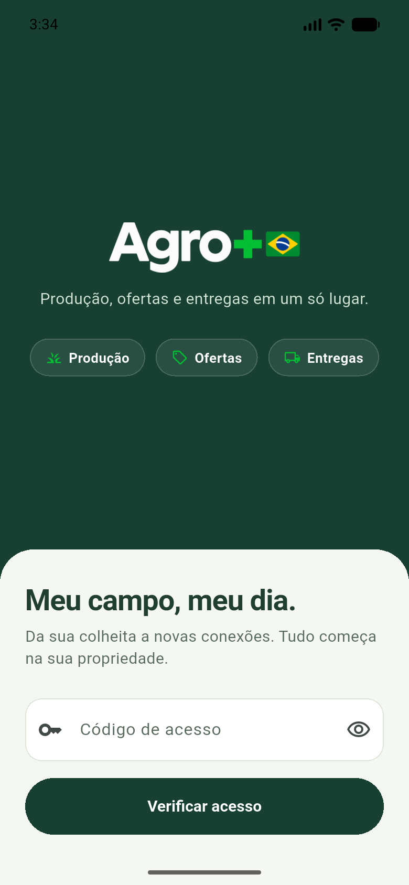 | 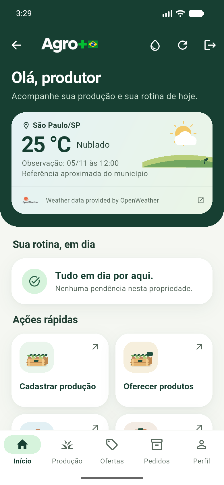 | 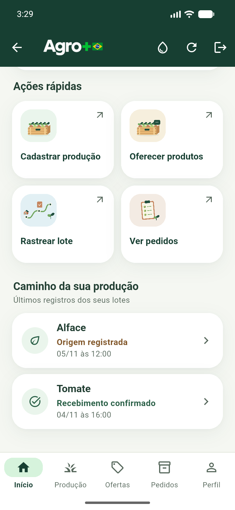 | 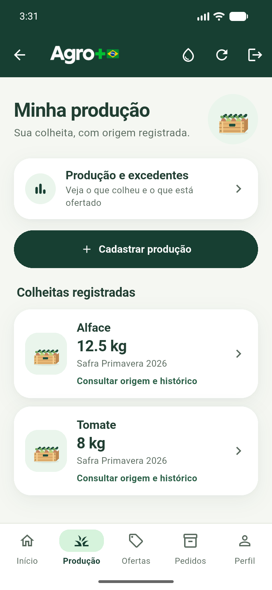 |
| Código de acesso e verificação | Saudação, clima e próxima ação | Ações rápidas e últimos lotes | Colheitas e acesso ao painel |

| Cadastro (formulário) | Ofertas | Pedidos | Histórico do lote |
| --- | --- | --- | --- |
| 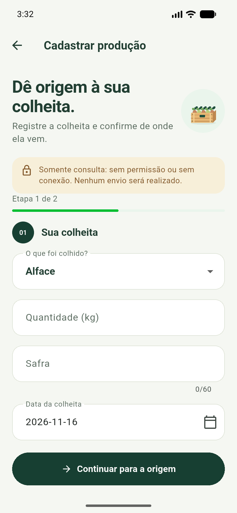 | 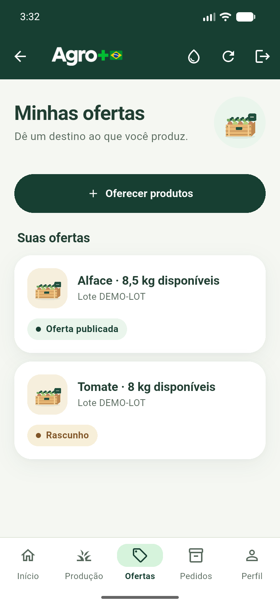 | 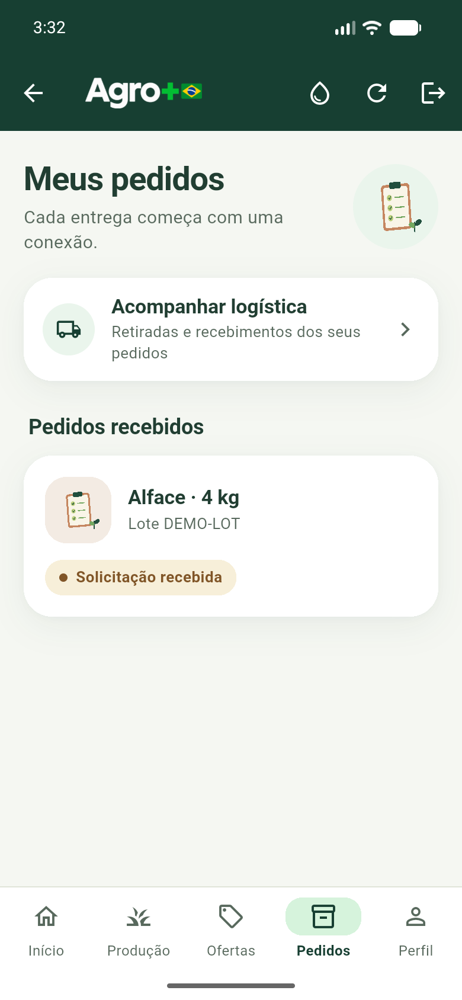 | 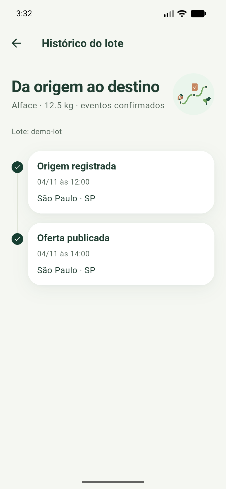 |
| Etapas com validação | Saldo disponível e situação | Pedidos e acesso à logística | Eventos confirmados |

| Dashboard 1 · Chuva | Gráfico mês a mês | Dashboard 2 · Produção e excedentes | Dashboard 3 · Logística |
| --- | --- | --- | --- |
| 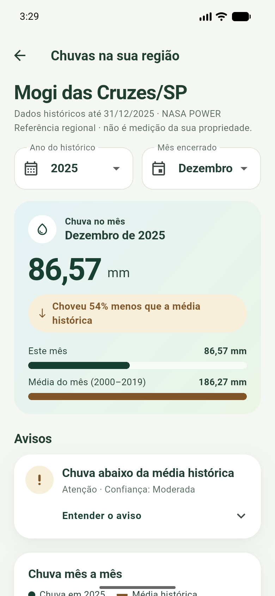 | 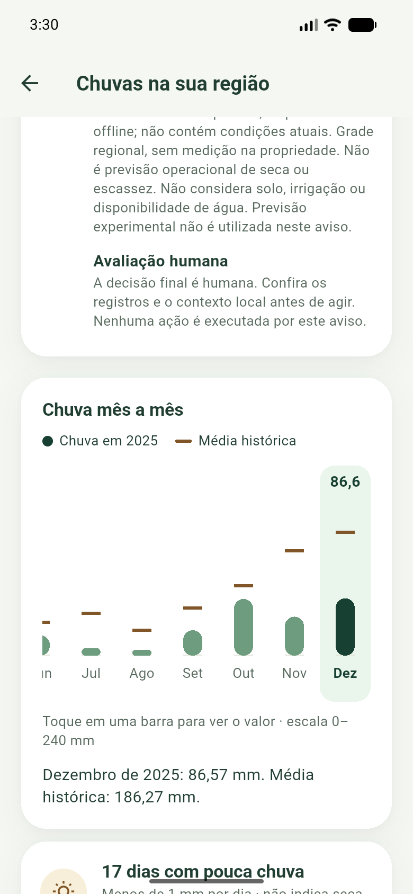 | 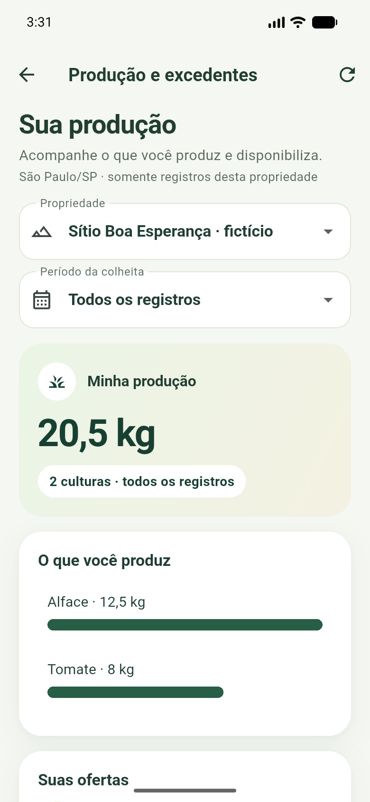 | 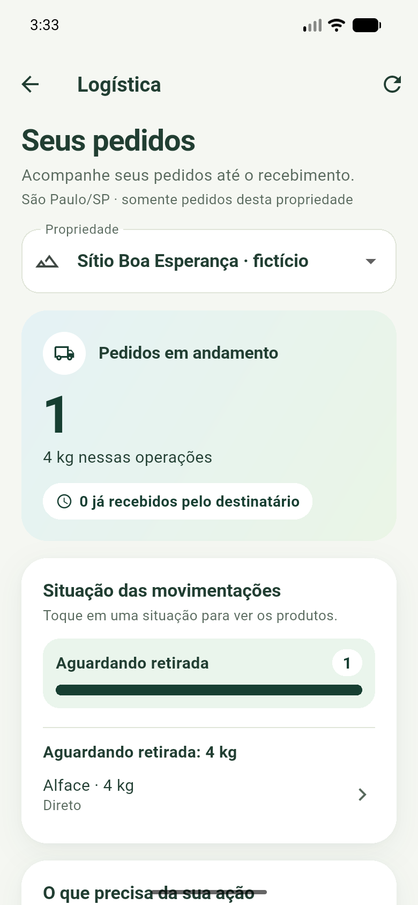 |
| Mês × média histórica | Barras e média por mês | Produção, culturas e ofertas | Pedidos por situação |

| Perfil | Editar perfil | | |
| --- | --- | --- | --- |
| 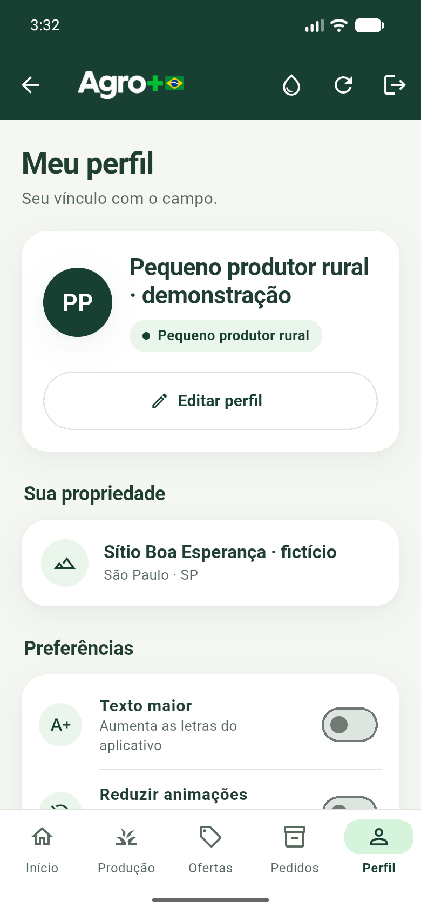 | 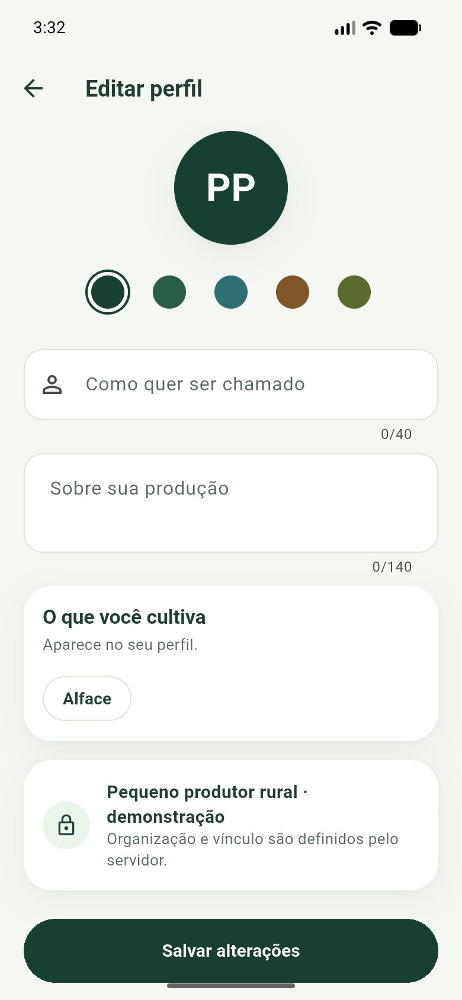 | | |
| Preferências de acessibilidade | Nome, culturas e cor | | |

### Avisos explicados

| Chuva | Produção | Logística |
| --- | --- | --- |
|  | 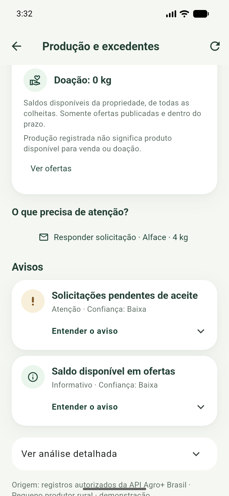 |  |
| 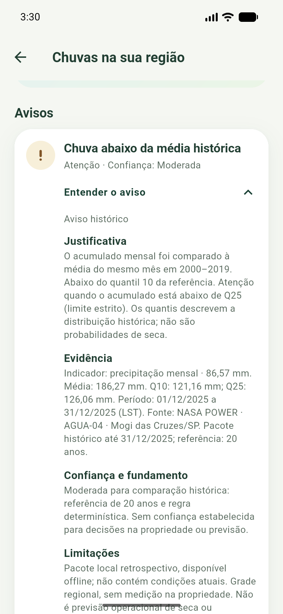 | 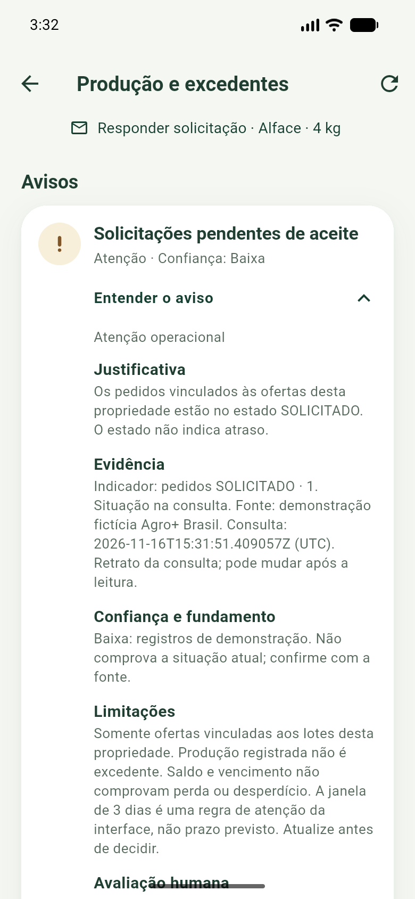 | 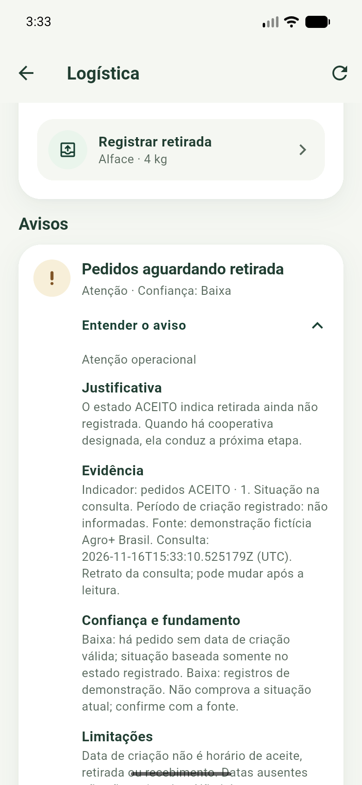 |

Também: [aviso de pedido aguardando resposta](assets/screenshots/alertas/logistica-aviso.png) e [Logística em 320 dp com texto 200%](assets/screenshots/alertas/logistica-retirada-320-texto-200.png).

## Funcionalidades

- [x] 5 abas (Início, Produção, Ofertas, Pedidos, Perfil) e telas de detalhe: cadastro, histórico do lote, três dashboards, edição de perfil
- [x] 3 dashboards territoriais distintos com gráficos, cards e histórico: Chuva (2000–2025), Produção e excedentes, Logística
- [x] Avisos gerados por regras sobre os dados, cada um com justificativa, evidência, nível de confiança e limitações
- [x] Aviso visível de que a decisão final é humana ("Avaliação humana" em cada aviso)
- [x] Estado global compartilhado (`HomeController` e preferências do perfil) entre várias telas
- [x] Carregamento, erro e lista vazia tratados em todas as listas e painéis
- [x] Consumo da API Agro+ Brasil (Express/MongoDB) e do clima (OpenWeather, via backend)
- [x] Persistência local: snapshot da home, catálogo, dashboards e preferências do perfil (SharedPreferences)
- [x] Útil sem conexão: cópia salva identificada como desatualizada; histórico de chuva embarcado
- [x] Formulários com validação e mensagens de erro: cadastro de produção, oferta e confirmação de operação
- [x] Indicador de benefício social: Destino dos excedentes (ofertado × recebido)
- [x] Edição e personalização do perfil (nome, sobre, culturas, cor do avatar, texto maior, menos animação)
- [x] Animações com propósito, que respeitam "remover animações" do sistema
- [x] Testes automatizados: 156 testes de unidade e widget (alertas, validações, layout, acessibilidade)
- [ ] Rotas nomeadas (a navegação usa `Navigator.push` com parâmetros no construtor)
- [ ] Etapa explícita de consentimento no app
- [ ] Modo escuro, mapa, notificações e APK de release

## Dados e alertas

**Fontes.** Registros de produção, ofertas, pedidos e eventos vêm da API Agro+ Brasil (seed de demonstração com participantes fictícios). A chuva é o histórico **NASA POWER AG** de Mogi das Cruzes/SP, 2000–2025, auditado no pipeline `analytics/agro-agua` e embarcado em `assets/agua04/`. O clima atual vem do OpenWeather pelo backend (a chave nunca fica no app).

**Como os avisos são gerados.** Regras determinísticas e testadas (`lib/territorial/explained_alert.dart`), sem probabilidades inventadas:

| Painel | Regra | Limites |
| --- | --- | --- |
| Chuva | Acumulado do mês abaixo da média do mesmo mês em 2000–2019; atenção abaixo do quantil 25 | Histórico regional, não é previsão de seca nem medição na propriedade |
| Produção e excedentes | Ofertas publicadas que vencem em até 72 h, solicitações pendentes e saldo ofertado | Produção registrada não é excedente; vencimento não prova perda |
| Logística | Pedidos aguardando resposta, retirada ou confirmação | Não cria atraso, rota, distância ou previsão de entrega |

**Métricas.** Média e quantis (Q10, Q25, Q75, Q90) do mesmo mês em 20 anos; anomalia em mm e em %; contagens e quilos dos registros autorizados.

**Confiança.** *Moderada* para comparação com 20 anos de referência ou leitura direta dos registros. *Baixa* para dados de demonstração, cópia offline, consulta com mais de 15 minutos, datas ausentes ou dados insuficientes. Confiança descreve a qualidade da evidência, não a chance de acerto futuro.

**Vieses e quando não confiar.** Grade regional de satélite (não mede a roça), referência de só 20 anos por mês, um único município de referência para qualquer propriedade, dados de demonstração e cópias antigas. Nesses casos o aviso mostra confiança baixa. O modelo Ridge do pipeline não é apresentado como previsão.

**Decisão humana.** Nenhum aviso executa ação: cada um termina com "Avaliação humana" e as ações abrem as telas operacionais. Detalhes: [relatório de alertas](../../docs/design/alertas/resultado.md).

## Privacidade e inclusão

**Privacidade**
- Acesso por código temporário, mantido só em memória; nunca em URL, assets, logs ou armazenamento local.
- A API isola dados por usuário, organização e propriedade; respostas 401/403/404 não usam cache.
- O cache guarda apenas dados já autorizados e sai com o logout. Preferências do perfil ficam só no aparelho e não são enviadas.
- Participantes do seed são fictícios. Coordenadas da propriedade só são usadas no clima com `verified` e `consent`; não há GPS automático.
- Lacuna conhecida: não há tela explícita de consentimento no app.

**Acessibilidade**
- Contraste verificado por teste (`textContrastGuideline`), alvos de toque de 48 dp e rótulos para leitores de tela.
- Layout testado em 320 dp e 390 dp, com texto em 200% e preferência "Texto maior" no perfil.
- Animações desligadas por "remover animações" do sistema ou pela opção "Reduzir animações".
- Linguagem simples em português, explicações técnicas recolhidas em "Ver análise detalhada".

## Tecnologias e decisões técnicas

| Tecnologia | Por quê |
| --- | --- |
| Flutter 3.47 / Dart 3.13 | Um código para Android e Web, com renderização consistente e boa acessibilidade |
| Material 3 + design system próprio (`lib/design.dart`) | Componentes reutilizáveis (`AgroSurface`, `IconBubble`, `FeatureTile`, `StatusPill`) e tokens de cor, tipografia e espaçamento |
| `ChangeNotifier` (`HomeController`) e `ValueNotifier` (`appPrefs`) | Estado global simples e explícito, sem dependências extras; estado local fica em cada tela |
| `http` | Cliente leve para a API REST |
| `shared_preferences` | Cache offline e preferências locais, isolados por origem/usuário/organização |
| `url_launcher` | Abrir fontes oficiais (OpenWeather, NASA POWER) |
| API Node.js 22 + Express 5 + MongoDB 6 | Autoridade de permissões e estados; transações em replica set |
| Dados NASA POWER embarcados | Histórico auditado funciona sem rede e sem endpoint extra |
| `flutter_test` + goldens | Garantia de regras, acessibilidade e aparência |

Estrutura:

```
lib/
  main.dart            entrada, tema, login e navegação por abas
  data.dart            repositório da API, cache e HomeController
  design.dart          tokens e componentes visuais
  motion.dart          animações (curvas, entrada escalonada, toque)
  home.dart, tasks.dart, records.dart, profile.dart   telas
  territorial/         dashboards, dados, regras de aviso e componentes
assets/                logo, fontes, ícone OpenWeather, dados AGUA-04, screenshots
test/                  testes de unidade, widget e goldens
```

## Como executar

Pré-requisitos: Flutter 3.47+, Node.js 22, MongoDB e um emulador Android.

```powershell
git clone https://github.com/matheeusvx/Agro-Brasil.git
cd Agro-Brasil
npm.cmd ci --cache .cache/npm
Copy-Item .env.example .env        # opcional: WEATHER_ENABLED e OPENWEATHER_API_KEY só no backend
npm.cmd run db:local               # terminal 1: MongoDB local
npm.cmd run seed:demo              # terminal 2: dados de demonstração e códigos de acesso
npm.cmd start                      # API em http://127.0.0.1:3000
```

No app (`apps/mobile`):

```powershell
flutter pub get
flutter test
./../../scripts/connect-android-local.ps1 -Device emulator-5554   # adb reverse da porta 3000
flutter run -d emulator-5554 --dart-define=API_BASE_URL=http://127.0.0.1:3000
```

Entre com o código de pequeno produtor gerado em `.data/demo-sessions.json` (não publique esse arquivo). Para ver o app sem backend, use a galeria de demonstração: `flutter run --dart-define=DEMO_GALLERY=true`.

Detalhes de conexão Android, web e testes de fumaça: [README da raiz](../../README.md) e [conexão Android](../../docs/design/production/conexao-android.md).

## Vídeo

Link do vídeo de demonstração (até 3 minutos): https://www.youtube.com/watch?v=mSOO8oRYhpI

## Licença

Projeto acadêmico — FIAP, Global Solution 2026.2. Uso educacional; sem garantia para uso em produção. Dados NASA POWER e OpenWeather seguem as licenças de suas fontes. A fonte Roboto acompanha sua licença em `assets/fonts/roboto_license.txt`.
