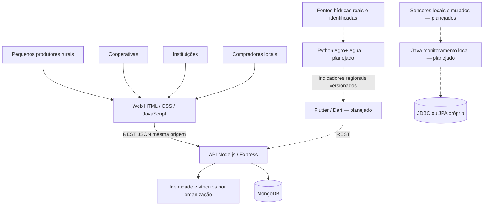

# Arquitetura técnica — 05/11/2026

## Módulos e comunicação

Linhas pontilhadas representam integrações ou módulos ainda não implementados. O Java não depende da API; os dados locais simulados não alimentam a análise regional real como se fossem observações reais.

## Decisões

1. **Monorepositório no diretório atual.** Uma raiz de dependências JavaScript e módulos separados por responsabilidade. Sem framework web, ORM, broker ou novos microsserviços.
2. **Express 5 e driver oficial MongoDB.** Rotas HTTP, middleware de autorização, funções de domínio testáveis e conexão centralizada. O lockfile registra as versões efetivamente instaladas.
3. **Produção como agregado inicial.** Lote e evento inicial são embutidos em `productions`; um `insertOne` evita produção sem lote ou lote sem origem, sem exigir replica set e transação distribuída. Índice único de `lot.id`.
4. **Segundo incremento.** Preservados produção, lote e origem inicial embutidos. Novas ofertas, pedidos e eventos têm coleções próprias; remessa/recebimento são embutidos no pedido, um por pedido. Transações reais de replica set coordenam saldo, estado, evento e comando idempotente. Novos eventos não são acumulados no documento da produção. Detalhes e limites em [incremento-2.md](incremento-2.md).
5. **Identidade mínima justificável.** Tokens demo opacos aleatórios, hash SHA-256 no banco, expiração e validação de usuário/vínculo ativos a cada requisição. Sem login/senha, JWT, OAuth ou conta real nesta etapa. É um adaptador local de identidade, não autenticação pronta para produção.
6. **Autorização efetiva.** O header de organização seleciona o contexto; não é prova de acesso. O backend exige vínculo ativo, tipo de organização e papel. `organizationId` e responsável não são aceitos do corpo. Todas as consultas de produção/lote filtram pela organização. Leitura cruzada por identificador retorna 404.
7. **Dados compartilhados com exposição restrita.** Os quatro públicos usam o mesmo serviço. Compartilhar a infraestrutura não significa tornar produção e histórico privados públicos. Ofertas publicadas têm projeção comercial própria; pedidos/remessas liberam somente as operações dos participantes. Histórico externo inclui origem e eventos dos pedidos da organização autorizada, sem identidades pessoais dos responsáveis de outras organizações.
8. **Mesma origem para a primeira web.** Express entrega arquivos estáticos e API, sem CORS aberto. Mobile exigirá endereço acessível e configuração de ambiente própria na próxima etapa.
9. **MongoDB portátil só para desenvolvimento/teste.** Binário oficial, WiredTiger, replica set de um nó, bind loopback e dados locais; nenhuma instalação como serviço, Atlas ou Docker necessário. A aplicação usa o driver e também funciona com MongoDB externo configurado como replica set. Um nó habilita transações, mas não oferece alta disponibilidade.
10. **Eventos de confirmação, não GPS.** Município/UF são declarados e confirmados pelo participante; não são validação geográfica independente. Horário UTC do registro distinto da data de colheita; o evento inicial significa registro da origem, não presença física verificada no instante do cadastro.

## Segurança e limites

Validação explícita, IDs UUID, números finitos, precisão de grama, referências ativas, corpo JSON até 16kb, paginação limitada, erros sem URI/stack, CSP, sem armazenamento persistente de token na web. O modo demo inicia somente em loopback e permanece desligado por padrão sem `.env`.

Banco local não tem autenticação de produção; não deve ser exposto. Cadastro de organizações/usuários, validação da legitimidade de um pequeno produtor rural, recuperação de acesso e gestão de vínculos são futuros. A política planejada exige autorização de administradores e auditoria. Nenhum usuário pode obter privilégios escolhendo um perfil na interface.

## Referências primárias consultadas

- Express 5: https://expressjs.com/en/5x/starter/installing/
- Driver oficial MongoDB: https://www.mongodb.com/docs/drivers/node/current/connect/mongoclient/

As decisões usam o SDK instalado e os contratos deste repositório. A referência não é evidência de funcionalidade executada; resultados estão em `docs/evidencias`.
