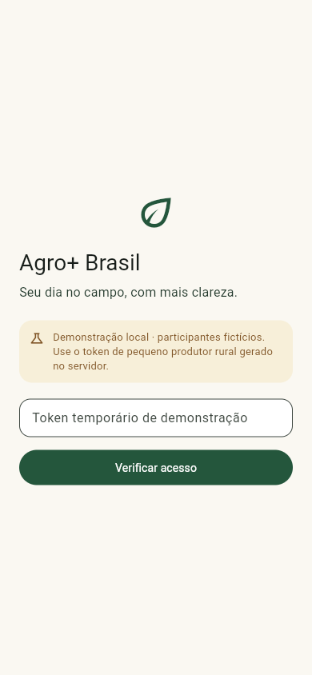

# Correção da inicialização Flutter Web — 05/11/2026

## Causa raiz demonstrada

O build anterior usava CanvasKit do CDN `https://www.gstatic.com/flutter-canvaskit/a804b261645ef8c13eb3d5c44a5c2fb0340c5539/chromium/`. A CSP existente do Express permitia apenas a própria origem para scripts e conexões. O navegador bloqueava o motor gráfico antes da inicialização da interface Dart. Isso ocorria no Edge e no Brave, em perfis novos e isolados, sem reutilizar cookies/sessões pessoais. Portanto, a falha não depende de cache prévio ou da chave OpenWeather.

Erros exatos relevantes, preservados integralmente nos JSON anteriores:

```text
Connecting to 'https://www.gstatic.com/flutter-canvaskit/a804b261645ef8c13eb3d5c44a5c2fb0340c5539/chromium/canvaskit.wasm' violates the following Content Security Policy directive: "connect-src 'self'". The action has been blocked.

Loading the script 'https://www.gstatic.com/flutter-canvaskit/a804b261645ef8c13eb3d5c44a5c2fb0340c5539/chromium/canvaskit.js' violates the following Content Security Policy directive: "script-src 'self' 'wasm-unsafe-eval'". Note that 'script-src-elem' was not explicitly set, so 'script-src' is used as a fallback. The action has been blocked.

Failed to fetch dynamically imported module: https://www.gstatic.com/flutter-canvaskit/a804b261645ef8c13eb3d5c44a5c2fb0340c5539/chromium/canvaskit.js
```

[Console/Network anterior Edge](before-edge.json), [Brave](before-brave.json), [tela branca Edge](before-edge.png), [tela branca Brave](before-brave.png).

## Inspeção antes da correção

`apps/mobile/build/web` existia; index.html tinha `<base href="/mobile/">`. Página, bootstrap, main.dart.js, CanvasKit local, WebAssembly e FontManifest retornaram HTTP 200, sem redirecionamento; tipos text/html, text/javascript, application/wasm e application/json corretos. Os arquivos locais existiam, mas o bootstrap estava selecionando o CDN.

A comparação com HEAD 79093bd mostrou que web/index.html, lib/main.dart e lib/data.dart não tinham alterações. A CSP já existia e não tinha sido alterada pela integração meteorológica; a diferença em app.mjs era somente a injeção da coleção de geocodificação. As mudanças de WeatherSummary ocorrem após autenticação/home e não explicam bloqueio do motor anterior ao primeiro frame. A etapa OpenWeather havia gerado build sem o parâmetro --no-web-resources-cdn, ao contrário do comando documentado anteriormente.

## Correção

Reconstruído com o comando solicitado:

```powershell
flutter build web --base-href /mobile/ --no-web-resources-cdn
```

O build agora contém `useLocalCanvasKit: true`; o navegador carrega `/mobile/canvaskit/chromium/canvaskit.js` e `.wasm`. CSP preservada integralmente, sem autorizar CDN, unsafe-eval ou origens adicionais. Sem alterações de autenticação, negócios, contratos, rastreabilidade ou configuração meteorológica. Não foi necessário reiniciar Express: express.static entrega os novos arquivos do disco. Build e bancos permanecem ignorados pelo Git.

Adicionado comando repetível `npm.cmd run build:mobile` via scripts/build-mobile.mjs para evitar omitir a flag. `playwright-core` é dependência apenas de desenvolvimento, usa navegadores instalados e não baixa navegador.

## Teste real e evidências

Smoke automatizado em scripts/smoke-mobile.mjs:

- Inicia Express real em porta dinâmica, MongoDB real isolado e identidade demonstrativa fictícia; nunca usa mocks de HTTP ou de renderização.
- Renderiza login, preenche token apenas em memória, confirma HTTP 200 na autenticação e entra na home com clima NOT_CONFIGURED.
- Valida arquivos, MIME, base href e ausência de redirecionamentos; exige carregamento real de WASM/fontes locais e nenhuma resposta >=400, requestfailed ou erro de Console.
- Bloqueia acessos externos durante o teste: o build precisa funcionar com recursos locais. Exercita reload na mesma sessão do navegador; uma sessão autenticada é apenas em memória e retorna ao login no reload.
- Perfis temporários, sem abrir a sessão pessoal do Brave. Não registra token, Authorization, request bodies ou capturas do token preenchido.
- Modo --existing também autentica contra o servidor e seed atuais da porta 3000, sem escrever dados agrícolas.

Resultados:

| Execução | Resultado |
|---|---|
| Edge com Express/MongoDB iniciados pelo smoke | Aprovado |
| Edge em http://127.0.0.1:3000/mobile/ | Aprovado |
| Brave em http://127.0.0.1:3000/mobile/ | Aprovado |
| flutter analyze | Sem issues |
| flutter test | 42 aprovados, inclusive goldens existentes |
| npm run check | Sintaxe aprovada |
| npm test | 23 aprovados |
| Build solicitado | Concluído |

[Resultado isolado](smoke-edge/result.json), [Edge porta 3000](live-edge/result.json), [Brave porta 3000](live-brave/result.json). Os resultados incluem recursos efetivamente carregados, status, MIME e erros vazios. [Análise](flutter-analyze.txt), [testes](flutter-tests.txt), [build](build.txt).

### Capturas reais após a correção — 390 × 844




A inspeção visual confirmou interface renderizada, identificação de demonstração e estado climático discreto. OpenWeather permanece desabilitado, sem chave fictícia e sem consulta meteorológica real. Não foi inspecionado/alterado o perfil pessoal ou o cache da aba já aberta no aplicativo Codex; recarregue a página para receber o build corrigido. O problema também foi reproduzido em perfis limpos, e reload após correção passou nos dois navegadores.

## Arquivos desta correção

- package.json e package-lock.json: playwright-core de desenvolvimento e comandos build:mobile/test:mobile:smoke.
- scripts/build-mobile.mjs e scripts/smoke-mobile.mjs: build consistente e smoke real.
- README.md e apps/mobile/README.md: comandos e pré-requisitos.
- docs/evidencias/flutter-web-startup/: capturas e resultados antes/depois.
- apps/mobile/build/web/: reconstruído localmente, ignorado pelo Git.

As alterações OpenWeather anteriores foram preservadas. Nenhum commit/push realizado.

Referências oficiais: [build web e recursos locais](https://docs.flutter.dev/deployment/web), [configuração do loader/CanvasKit](https://docs.flutter.dev/platform-integration/web/initialization).
